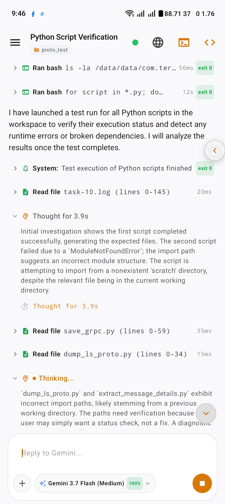
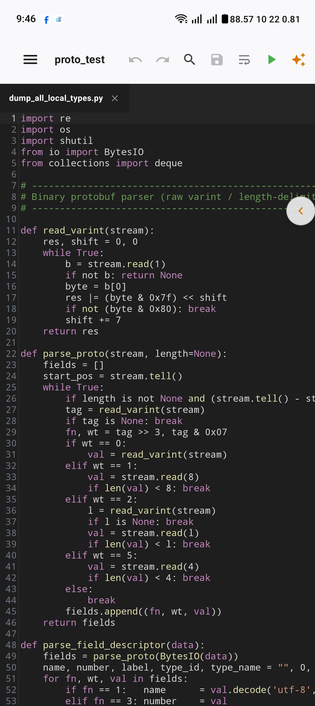
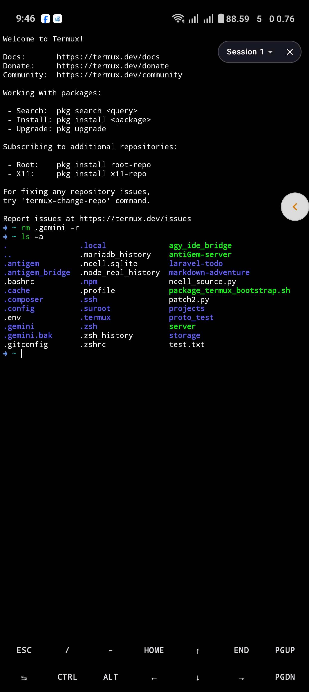
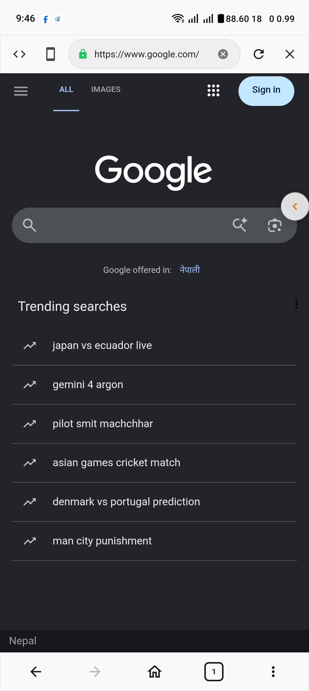
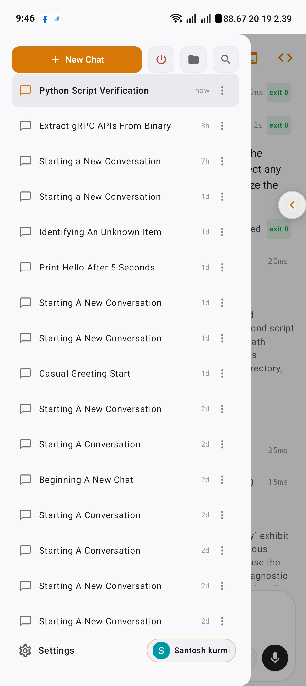
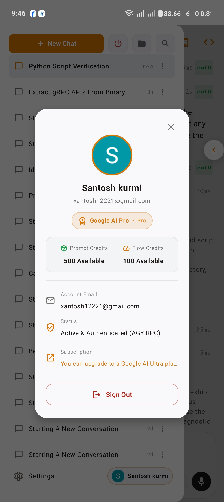
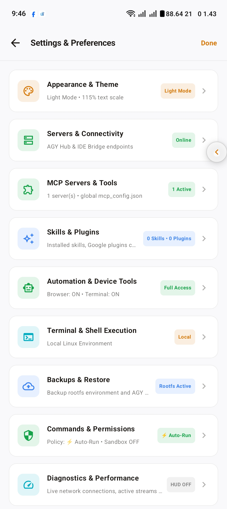
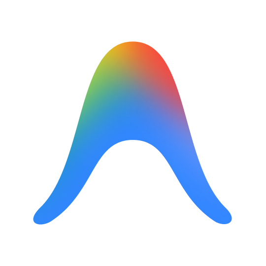

<div align="center">

<p align="center">
  
</p>

# AntiGem

<p align="center">
  <b>Autonomous AI Coding Workspace and Native Integrated Development Environment for Android</b><br>
  Built on the Google Antigravity Engine, Wire gRPC Architecture, Embedded Linux PTY Subsystem, and Sora Code Editor.
</p>

<p align="center">
  <a href="https://github.com/ejjeejduddu-arch/antigemxxx/releases/latest">
    
  </a>
  <a href="https://github.com/ejjeejduddu-arch/antigemxxx/actions/workflows/release.yml">
    
  </a>
  <a href="https://developer.android.com/jetpack/compose">
    
  </a>
  <a href="https://go.dev">
    
  </a>
  <a href="https://grpc.io">
    
  </a>
  <a href="LICENSE">
    
  </a>
</p>

<p align="center">
  <a href="https://github.com/ejjeejduddu-arch/antigemxxx/releases/latest"><b>Download Binary APK</b></a> |
  <a href="#system-architecture"><b>Architecture</b></a> |
  <a href="#core-capabilities"><b>Capabilities</b></a> |
  <a href="#interface-overview"><b>Screenshots</b></a> |
  <a href="extension_docs/README.md"><b>Plugin SDK</b></a>
</p>

</div>

---

## Technical Specifications

<table>
  <thead>
    <tr>
      <th align="left">Component</th>
      <th align="left">Technology</th>
      <th align="left">Implementation Details</th>
    </tr>
  </thead>
  <tbody>
    <tr>
      <td><b>AI Agent Core</b></td>
      <td>Google Antigravity Language Server (gRPC)</td>
      <td>Binary protocol streaming via Square Wire runtime with suspending RPC calls and background subagent orchestration.</td>
    </tr>
    <tr>
      <td><b>Secondary Agent</b></td>
      <td>Claude Code CLI Protocol</td>
      <td>Daemonized process communication over JSON stream protocol with interactive user tool approvals and diff rendering.</td>
    </tr>
    <tr>
      <td><b>Terminal Engine</b></td>
      <td>Native Termux PTY Subsystem</td>
      <td>Hardware-accelerated pseudoterminal emulation (v0.118.1), ANSI/xterm-256color support, and persistent background daemons.</td>
    </tr>
    <tr>
      <td><b>Code Editor</b></td>
      <td>Sora Editor (v0.23.6)</td>
      <td>High-speed TextMate syntax highlighting for 50+ languages, code folding, bracket matching, and Git status indicators.</td>
    </tr>
    <tr>
      <td><b>Automation Hub</b></td>
      <td>Model Context Protocol (MCP)</td>
      <td>Extensible JSON-RPC bridge allowing autonomous tools to inspect DOM trees, capture viewport frames, and manage device assets.</td>
    </tr>
    <tr>
      <td><b>Authentication Engine</b></td>
      <td>Google OAuth 2.0 PKCE & Local Callback</td>
      <td>Direct authorization code exchange with local callback verification on port 51121, Material 3 startup screen, and offline workspace fallback.</td>
    </tr>
    <tr>
      <td><b>Mathematical Canvas</b></td>
      <td>JLaTeXMath Native Engine</td>
      <td>Hardware-accelerated mathematical typography and KaTeX formula rendering directly on Android Canvas with zero WebView overhead.</td>
    </tr>
  </tbody>
</table>

---

## Interface Overview

<table>
  <tr>
    <td align="center" width="25%">
      <br><br>
      <b>Autonomous Agent Console</b><br>
      <sub>Real-time thought stream, multi-turn reasoning, and live diff inspection</sub>
    </td>
    <td align="center" width="25%">
      <br><br>
      <b>Sora IDE Code Editor</b><br>
      <sub>TextMate syntax highlighting, multi-tab buffer, and tree explorer</sub>
    </td>
    <td align="center" width="25%">
      <br><br>
      <b>Native Linux PTY Terminal</b><br>
      <sub>Direct Termux environment, package managers, and compiler toolchains</sub>
    </td>
    <td align="center" width="25%">
      <br><br>
      <b>Automated Inspection Browser</b><br>
      <sub>Agent-controlled DOM inspection, network telemetry, and localhost testing</sub>
    </td>
  </tr>
  <tr>
    <td align="center">
      <br><br>
      <b>Workspace & Session Router</b><br>
      <sub>Multi-project switching, branch switching, and persistence</sub>
    </td>
    <td align="center">
      <br><br>
      <b>Resource & Telemetry Monitor</b><br>
      <sub>Real-time token utilization, context window limits, and server metrics</sub>
    </td>
    <td align="center">
      <br><br>
      <b>Advanced Preferences & MCP</b><br>
      <sub>Plugin catalog, port forwarding, and execution policies</sub>
    </td>
    <td align="center">
      <br><br>
      <b>Google Antigravity</b><br>
      <sub>Official integrated AI core engine</sub>
    </td>
  </tr>
</table>

---

## Core Capabilities

### 1. Google Antigravity AI Engine
AntiGem integrates directly with the Google Antigravity language server via high-speed gRPC over Unix Domain Sockets and localhost TCP.
- **Structured Wire Protocol**: Communicates via Wire-generated Kotlin protobuf stubs (`LanguageServerService.proto`), eliminating serialization bottlenecks.
- **Deep Reasoning Engine**: Renders collapsible agent thinking trees, AST diff inspections, and multi-file code revisions before execution.
- **Subagent Delegation**: Orchestrates child agents (`research`, `fullstack-builder`, `tester`) running in isolated parallel workspaces.

### 2. High-Performance Sora Code Editor
- **Syntax Engine**: Utilizes TextMate grammars supporting Kotlin, Java, Python, Go, Rust, C/C++, TypeScript, HTML/CSS, SQL, JSON, and YAML.
- **Git Integration**: Built-in visual diff comparison, staging controls, and branch management without external tooling.
- **Native Canvas LaTeX**: Direct mathematical typesetting using native JLaTeXMath, rendering complex equations without browser lag.

### 3. Native Linux PTY Terminal
- **Direct PTY Session**: Integrates Termux's terminal emulator directly into the Jetpack Compose surface.
- **Shell Support**: Full compatibility with Bash, Zsh, Fish, Node.js, Python, Clang, Rustc, and Git.
- **Daemon Architecture**: Background terminal sessions remain active while navigating code files or browser tabs.

### 4. Agent Browser & MCP Automation Hub
- **Headless & Headed Automation**: Allows AI agents to navigate web targets, fill input parameters, execute synthetic events, and capture full-page viewports.
- **Custom AntiGem Plugins**: Extensible plugin system to package custom Model Context Protocol tools, markdown skills, and automation scripts.
- **Google Flow Engine**: Integrated workflows for media generation, storyboard inspection, and automated code review pipelines.

---

## System Architecture

```
+-------------------------------------------------------------------------+
|                  AntiGem Android Client (Jetpack Compose)               |
+--------------------+--------------------+-------------------------------+
|   Agent Console    |  Sora Code Editor  |     Linux PTY Terminal        |
+--------------------+--------------------+-------------------------------+
          |                   |                           |
          v                   v                           v
+--------------------+ +--------------------+ +---------------------------+
|  Wire gRPC Client  | | TextMate Grammar   | |  libtermux.so Native PTY  |
+--------------------+ +--------------------+ +---------------------------+
          |                                               |
          v                                               v
+-------------------------------------------+ +---------------------------+
|   agy_ide_bridge (Go Native Daemon)       | | Termux Linux Environment  |
|   - LanguageServerService (Protobuf)      | | - Compilers & Toolchains  |
|   - Claude Code stream-json Relay         | | - Local Web Servers       |
|   - MCP Tool & Plugin Hub                 | | - Package Managers        |
+-------------------------------------------+ +---------------------------+
```

---

## Installation & Deployment

### Direct APK Installation
Download the official release APK built directly via GitHub Actions:

- **Download Link**: [antiGem-termux-v1.0.25-release.apk](https://github.com/ejjeejduddu-arch/antigemxxx/releases/download/v1.0.25/antiGem-termux-v1.0.25-release.apk)
- **Minimum Android Version**: Android 8.0 (API Level 26)
- **Target Android Version**: Android 14+ (API Level 34/36)
- **Supported Architectures**: `arm64-v8a`, `armeabi-v7a`, `x86_64`, `x86`

### Building from Source

Ensure Android SDK API 36, JDK 21, and Go 1.22+ are installed:

```bash
git clone https://github.com/ejjeejduddu-arch/antigemxxx.git
cd antigemxxx

chmod +x gradlew scripts/build_all_apks.sh

# Build Release APKs
./scripts/build_all_apks.sh --release
```

Generated APKs will be placed in the `output/` directory:
- `output/antiGem-termux-v1.0.25-release.apk` (Application ID: `com.antigravity.ai`)
- `output/antigravity-ai-v1.0.25-release.apk` (Application ID: `com.antigravity.ai`)

---

## Security and Verification

All release builds are compiled in clean, isolated GitHub Actions Ubuntu runners and cryptographically signed with RSA 2048-bit keys:

- **Keystore Type**: PKCS#12 / JKS
- **Signature Scheme**: APK Signature Scheme v2 & v3
- **R8 / Proguard**: Stripped debug logs, class obfuscation, and Dead Code Elimination (DCE) enabled

---

## License

AntiGem is licensed under the **GNU General Public License v3.0 (GPLv3)**.  
See the [LICENSE](LICENSE) file for terms and conditions.

<div align="center">
  <sub>Maintained by <a href="https://github.com/ejjeejduddu-arch">ejjeejduddu-arch</a> • Engineered with Google Antigravity & Kotlin Jetpack Compose</sub>
</div>
