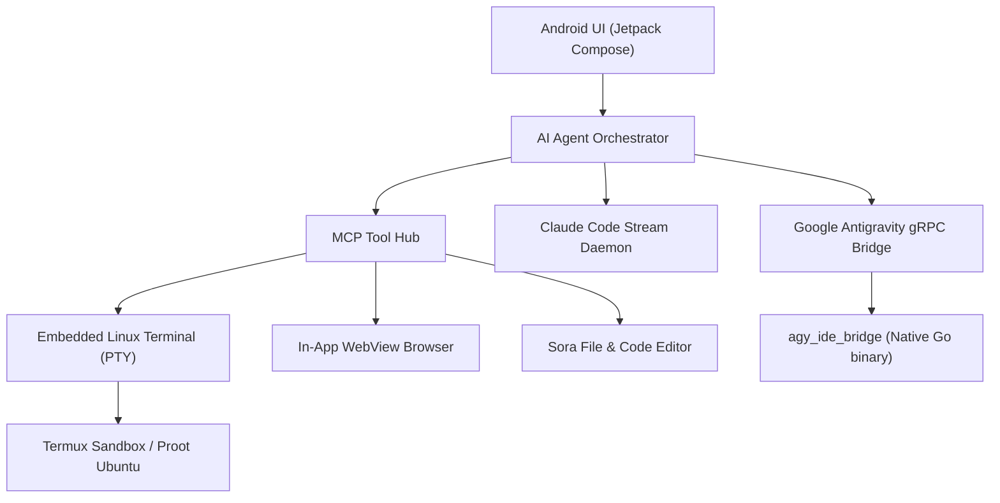

<p align="center">
  <picture>
    <source media="(prefers-color-scheme: dark)" srcset="docs/resources/antigravity_banner.png">
    
  </picture>
</p>

<h1 align="center">AntiGem — Google Antigravity AI & IDE for Android</h1>

<p align="center">
  <strong>The Ultimate Autonomous AI Coding Workspace for Mobile Devices</strong><br>
  Built with Google Antigravity & Claude Code agents, a full Linux PTY Terminal, Sora Code Editor, and an Agent-Controlled Browser in one unified native Android application.
</p>

<p align="center">
  <a href="https://github.com/ejjeejduddu-arch/antigemxxx/releases/latest">
    
  </a>
  <a href="https://github.com/ejjeejduddu-arch/antigemxxx/actions/workflows/release.yml">
    
  </a>
  <a href="https://developer.android.com/jetpack/compose">
    
  </a>
  <a href="https://go.dev">
    
  </a>
  <a href="LICENSE">
    
  </a>
</p>

<p align="center">
  <a href="https://github.com/ejjeejduddu-arch/antigemxxx/releases/latest"><b>⚡ Download Latest APK</b></a> •
  <a href="#-key-features"><b>✨ Features</b></a> •
  <a href="#-screenshots"><b>📱 Screenshots</b></a> •
  <a href="#-system-architecture"><b>🏗️ Architecture</b></a> •
  <a href="extension_docs/README.md"><b>🔌 Plugin SDK</b></a>
</p>

---

## 📱 Screenshots

<table>
  <tr>
    <td align="center" width="25%">
      <br>
      <b>💬 Autonomous AI Chat</b><br>
      <sub>Real-time thought stream & diffs</sub>
    </td>
    <td align="center" width="25%">
      <br>
      <b>📝 Sora Code Editor</b><br>
      <sub>TextMate themes & file tree</sub>
    </td>
    <td align="center" width="25%">
      <br>
      <b>💻 Linux PTY Terminal</b><br>
      <sub>Native Termux session & zsh/bash</sub>
    </td>
    <td align="center" width="25%">
      <br>
      <b>🌐 Agent Browser</b><br>
      <sub>MCP automation & DOM inspect</sub>
    </td>
  </tr>
  <tr>
    <td align="center">
      <br>
      <b>📂 Workspace & Chats</b><br>
      <sub>Instant project switching</sub>
    </td>
    <td align="center">
      <br>
      <b>📊 Quota & Telemetry</b><br>
      <sub>Live token & model monitor</sub>
    </td>
    <td align="center">
      <br>
      <b>⚙️ Preferences & MCP</b><br>
      <sub>Custom plugins & skills</sub>
    </td>
    <td align="center">
      <br>
      <b>✨ Google Antigravity</b><br>
      <sub>Original AI Core</sub>
    </td>
  </tr>
</table>

---

## 🚀 Key Features

### 🤖 Dual AI Agent Architecture
- **Google Antigravity (`agy`) Engine**: Communicates directly with Google Antigravity via high-performance gRPC. Features full structured output streaming, collapsible reasoning/thinking trees, subagent spawning, and tool approval workflows.
- **Claude Code CLI**: Anthropic's official `claude` CLI daemon embedded seamlessly via stream-json protocol with process isolation.
- **Dynamic Model Switching**: Switch seamlessly between Gemini 2.5 Flash, Gemini Pro, Claude 3.7 Sonnet, and custom models mid-chat.

### 💻 Embedded Native Linux Terminal
- **Native PTY Emulation**: Powered by Termux's battle-tested terminal engine with full ANSI color support, xterm-256color, and UTF-8.
- **Background Persistence**: Run long compile tasks, package installations, and Node.js/Python servers in the background without UI freeze.
- **Termux & Proot Ubuntu**: Direct access to APKs, compilers, git, curl, and python environments inside mobile sandbox.

### 📝 Sora Code Editor
- **Modern Android IDE Experience**: Fast, smooth code editor supporting syntax highlighting for 50+ languages via TextMate grammars.
- **Integrated Git Client**: Inspect modified files, visual diff viewer, stage changes, and push directly to GitHub.
- **Mathematical Rendering**: Pure Android Canvas JLaTeXMath renderer for rich LaTeX and KaTeX formulas with zero WebView overhead.

### 🌐 Autonomous Browser & MCP Hub
- **Agent Browser Automation**: Allows Antigravity agents to browse the live web, test local web apps (`localhost:port`), take high-res viewport screenshots, and inspect DOM elements.
- **Custom AntiGem Plugins**: Install and create plugins with Model Context Protocol (MCP) tools and markdown skills.
- **Google Flow Workflows**: Built-in video studio, script storyboard analyzer, and auto-dispatch media generator.

---

## 📦 Installation & Quick Start

### 1. Download APK
Get the verified release directly from the repository:
- **[Download antiGem-termux-v1.0.20-release.apk](https://github.com/ejjeejduddu-arch/antigemxxx/releases/latest)**

### 2. Install on Android
1. Open the downloaded APK file and tap **Install** (Enable *"Install unknown apps"* if prompted).
2. Launch **AntiGem** and follow the 1-click initial setup.

### 3. Quick Connect to Termux (Optional)
If running with external Termux:
```bash
# In Termux terminal
pkg update && pkg install openssh git gh
sshd
```

---

## 🏗️ System Architecture



---

## 🛠️ Tech Stack & Dependencies

- **Framework**: Kotlin 2.1, Jetpack Compose, Material 3
- **IDE Bridge**: Go 1.22 (`agy_ide_bridge` compiled with `-ldflags="-s -w"`)
- **Networking & Serialization**: OkHttp 4.12, Kotlinx Serialization, Wire gRPC
- **Terminal View**: Termux Terminal Emulator Engine (`terminal-emulator:v0.118.1`)
- **Editor**: Sora Editor (`io.github.Rosemoe.sora-editor:editor:0.23.6`)
- **Image & Renderers**: Coil Compose, JLaTeXMath Canvas, Markwon

---

## 📄 License

AntiGem is open-source software licensed under the **GNU General Public License v3.0 (GPLv3)**.  
See the [LICENSE](LICENSE) file for complete details.

<p align="center">
  <sub>Built with ❤️ for mobile developers and AI enthusiasts by <a href="https://github.com/ejjeejduddu-arch">ejjeejduddu-arch</a></sub>
</p>
